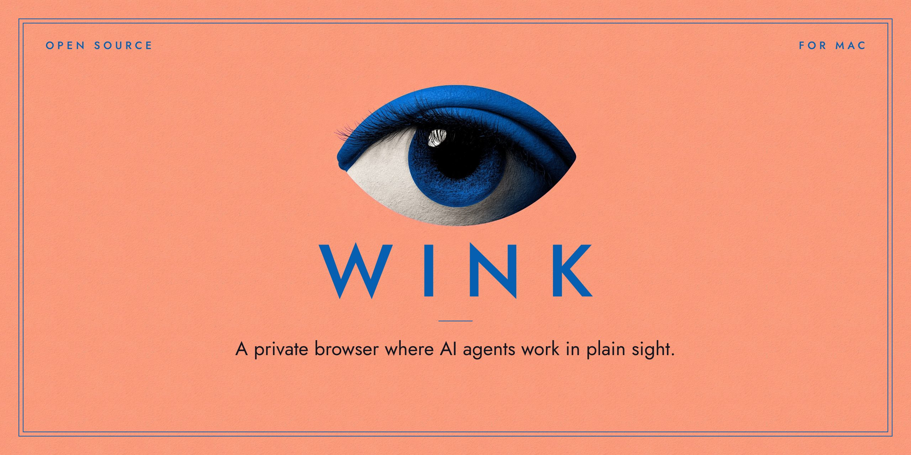
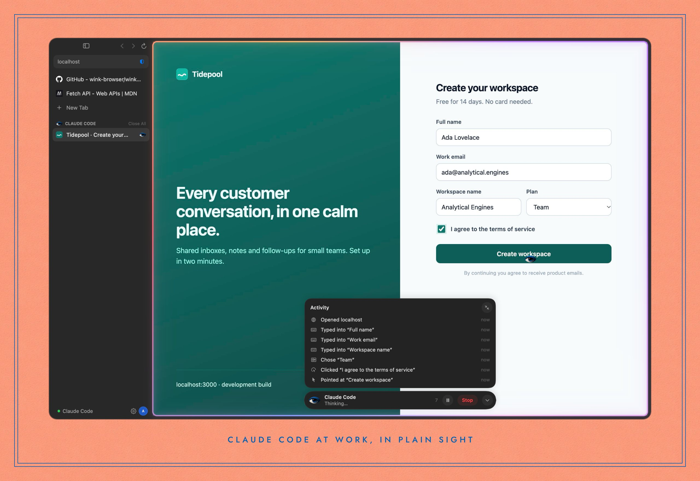

  

  <a href="https://wink.minnebo.ai/download"><b>Download for Mac</b></a>
  &nbsp;·&nbsp;
  <a href="https://github.com/wink-browser/wink">Source code</a>
  &nbsp;·&nbsp;
  <a href="https://wink.minnebo.ai/vs-playwright">Wink vs Playwright</a>
  &nbsp;·&nbsp;
  <a href="https://wink.minnebo.ai">Website</a>

**Wink is an open-source web browser for macOS, built on Chromium, where AI agents work in plain sight.** Claude Code, or any MCP client, browses with it through a built-in MCP server, in fewer steps than Playwright. You watch every step, pause or stop at any time, and Wink asks before an agent sends, buys, deletes or connects. Underneath it's a fast, private Mac browser: native AppKit and SwiftUI, 93k tracker domains blocked, no account.

  

### Repositories

<table>
  <tr>
    <td><a href="https://github.com/wink-browser/wink"><b>wink</b></a></td>
    <td>The browser: Swift, Objective-C++ and Chromium, with the MCP server, the agent tools and the privacy engine. Apache-2.0.</td>
  </tr>
  <tr>
    <td><a href="https://github.com/wink-browser/releases"><b>releases</b></a></td>
    <td>Signed, notarized downloads, and the notes for every release.</td>
  </tr>
</table>

### Try it in a minute

1. [Download Wink](https://wink.minnebo.ai/download) (macOS 14 or later, Apple silicon), move it to Applications and open it once. If Claude Code is installed, Wink adds itself to Claude Code's MCP servers.
2. Ask Claude Code: *"Open localhost:3000 in Wink, sign up with a test account, and tell me what errors show up in the console."*
3. For CI or parallel agents, `wink-mcp --headless` gives each agent its own invisible, throwaway Wink.

### By the numbers

<table>
  <tr><td align="right"><b>37</b></td><td>MCP tools, each built to save the agent a turn</td></tr>
  <tr><td align="right"><b>46%</b></td><td>fewer tokens than Playwright MCP, over eleven tasks with Claude Sonnet 5.5 (<a href="https://wink.minnebo.ai/vs-playwright">how we measured</a>)</td></tr>
  <tr><td align="right"><b>93k</b></td><td>tracker and ad domains turned away</td></tr>
  <tr><td align="right"><b>¼&nbsp;s</b></td><td>from launch to ready</td></tr>
</table>

### Get involved

Bug reports, ideas and pull requests are welcome: start with [CONTRIBUTING.md](https://github.com/wink-browser/wink/blob/main/CONTRIBUTING.md) and the [open issues](https://github.com/wink-browser/wink/issues). Report security problems privately, through a [security advisory](https://github.com/wink-browser/wink/security/advisories/new).

 

   
  Made in Luxembourg · Open source under Apache 2.0

